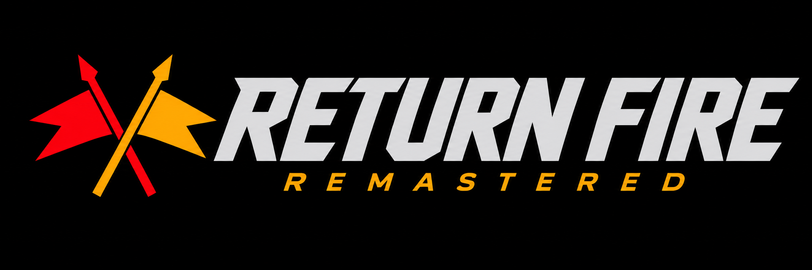

# Return Fire Remastered

Play your original Windows edition of *Return Fire* on Windows 11 with its 256-colour battlefield, keyboard controls, sound effects and vehicle themes. This unofficial kit brings the original executable to a modern display. You supply the game.

## First launch

1. Download the repository ZIP from GitHub (**Code → Download ZIP**) and extract it into a writable folder.
2. Prepare one of the English Windows PC editions below.
3. Double-click **Play.cmd** and select the folder containing **RFIRE.BIN**. The first setup imports your files into **PrivateGame** and downloads a checksum-verified copy of cnc-ddraw. Later launches work offline.

| Your edition | Folder to select | Music |
| --- | --- | --- |
| English ISO | Mount the extracted disc image in Explorer and select its drive, or select the root of the extracted image. It should contain Langs and Sound. | The tested disc includes the full score. The tank plays *Mars, the Bringer of War* and the helicopter plays *Ride of the Valkyries*. |
| English RIP | Extract the archive and select the inner returnfire folder. | The tested RIP has a 20-byte score placeholder. Engine and weapon effects use separate files. |

Use a separate kit folder for each edition. Once installed, the launcher reuses its local game data. If Windows blocks a downloaded copy you trust, open the ZIP's Properties, select **Unblock** if available and extract again.

## Picture, sound and films

The default 1080p profile centres the original 4:3 frame on a borderless display. At 1920×1080 the battlefield occupies 1440×1080, preserving vehicle and HUD proportions. The original game still draws at 640×480. Live Windows 11 checks confirmed the repaired palette.

Run these examples in a command prompt inside the kit folder.

| Command | Effect |
| --- | --- |
| `Play.cmd -MovieFix` | Repairs the horizontal band across ISO films. Both the opening and mission-completion film passed live playback checks. The launcher checks the executable fingerprint and creates a separate local copy. Launch normally to restore standard playback. |
| `Play.cmd -Filter Sharp` | Uses nearest-neighbour scaling for crisp pixel edges. |
| `Play.cmd -Filter xBR` | Uses an optional OpenGL pixel-art shader. Reference frames have been compared. In-game driver compatibility still needs testing. |
| `Play.cmd -ProfileName 720p` | Selects the smaller HD profile. |
| `Play.cmd -ProfileName Original` | Selects the original-size profile. |
| `Play.cmd -WrapperZip "C:\Downloads\cnc-ddraw.zip"` | Uses a local copy of the pinned wrapper for an offline first setup. |

The default Smooth option requests Direct3D bicubic filtering. Its visible effect on the game's 8-bit frames depends on wrapper support. For offline installation, obtain the unmodified archive from the [cnc-ddraw 7.1.0.0 release](https://github.com/FunkyFr3sh/cnc-ddraw/releases/tag/v7.1.0.0).

## Full mission tests in v0.1.0

On Windows 11, a player completed one mission in each English edition using fresh installations from the downloaded v0.1.0 Windows ZIP.

- **RIP edition (`Play.cmd`).** The engine was audible while driving and individual shots were audible when firing. The player won the mission. The tested RIP contains a 20-byte music placeholder.
- **ISO edition (`Play.cmd -MovieFix`).** Engine and weapon sounds were audible alongside the score. The tank played *Mars, the Bringer of War*, and switching to the helicopter changed the music to *Ride of the Valkyries*. Winning the mission automatically started the original completion film. It played to the end without the horizontal black band.

## Moving or sharing the kit

Close the game before moving your personal installation. Move the whole extracted folder together. The launcher refreshes the game path at startup and uses a temporary drive mapping while playing. Controls and progress live in the Windows user registry and are shared by installations under that account. To share the kit, send a clean repository ZIP. Your installed folder contains your personal copy of the game.

## v0.2.0 development options

### Build the 16:9 films

Install Python 3 and FFmpeg with the libx264 encoder, and make both commands available on PATH. Mount or extract your English Windows ISO. In a command prompt inside the kit, run:

    Play.cmd -BuildCinematics -Source "D:\"

Replace D:\ with the mounted disc or extracted folder. You can omit the source to use your installed films or open the folder picker. The converter checks the five original STM fingerprints and writes rf.mp4 (opening) and win.mp4, win1.mp4, win2.mp4 and win3.mp4 (completion films) to **HD-Cinematics** beside Play.cmd. Each file plays in a regular MP4 player. To rebuild, rename the existing output folder first.

The conversion keeps the source frame rate of 15 fps and stereo audio. It crops the 320×240 picture to 320×180 before scaling to 1920×1080. The opening uses the corrected fire palette and a centred crop. The victory films use the lower framing selected for the parade. Keep these player-generated movies in your personal installation.

For in-game HD playback, install the optional display dependencies in the same Python environment and launch the ISO edition:

    python -m pip install opencv-python psutil
    Play.cmd -HDCinematics

The game controls skipping and audio. The HD picture follows the original film frame while the game has focus. The two studio idents use the native player.

### Try the wider battlefield

    Play.cmd -WidescreenTrial

This experimental option targets the fingerprinted English ISO executable. It builds a separate local executable with the native cinematic fix, requests an 856×480 display surface and expands the logical battlefield from 320×152 to 428×152. A normal launch selects the standard 4:3 game. Test the trial in a separate installation. In a Windows 11 VirtualBox guest at 1920×1080, the tank deployed on The Cakewalk in both modes. The wider view revealed additional terrain on both sides. The depot hazard stripes measured 147 screen pixels across in 4:3 and 146 in the trial. Driving and firing worked. The single-player HUD keeps its original width. The panel and instruments are centred beneath the battlefield, with equal margins on each side. The layout has been checked at The Cakewalk depot in the Windows 11 guest. Split-screen and a full widescreen mission remain untested.

## Where the remaster goes next

- **More battlefield at 16:9.** Check the centred HUD through a complete mission, additional vehicles and split-screen.
- **HD cinematics.** The builder reproduces all five approved 1920×1080 previews from player-owned media. The HD opening has run in game. Verify the automatic transition from a mission win into the player-built HD completion film.
- **Graphics and platform testing.** Compare xBR with the default renderer in motion, then test installation, sound and input under Wine on Linux.

## Credits and licensing

The project MIT licence covers the launcher and its documentation. The bundled xBR shader carries its own author credit and MIT notice. The original game, music and cinematics belong to their respective rights holders and are supplied by the player. The display wrapper is distributed by its own maintainers. [Project licence](LICENSE) · [Shader notice](xbr-lv2-noblend.glsl) · [cnc-ddraw](https://github.com/FunkyFr3sh/cnc-ddraw)
